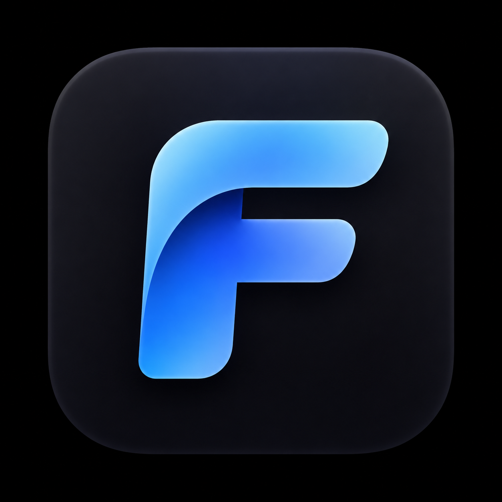

<p align="center"></p>

# Folix

Двухпанельный файловый менеджер для macOS в духе Total Commander, но в стиле Mac.
Работает с файлами на Mac, внешних дисках, Android-телефонах, PS Vita, Nintendo Switch и PS3.

## Возможности

- **Две панели**: копирование и перемещение между любыми устройствами (F5 / F6), новая папка (F7), удаление (F8), переименование (⇧F6).
- **Устройства**:
  - Mac и внешние диски (USB, HDD, SSD, SD-карты);
  - Android по USB (через `adb`, нужна «Отладка по USB») или по FTP;
  - PS Vita (VitaShell, FTP), Nintendo Switch (ftpd / DBI, FTP), PS3 (webMAN MOD, FTP).
- **Размеры папок** считаются сами: на Mac при запуске, на устройствах при подключении. Кэш хранится сутки в зашифрованном виде (AES-256, ключ в Связке ключей macOS).
- **Программы**: список приложений с размером каждого.
- **Превью при наведении**: фото, кадр из видео, обложки игр PS3 и Vita.
- **Просмотр** фото, видео и текста (F3), окно **«Информация»** (⌘I).
- **Правый клик**: копировать, вырезать, вставить, удалить, свойства. ⌘C / ⌘X / ⌘V работают и вместе с Finder.
- **Иконки по типам файлов**: APK, EXE, архивы, VPK, NSP/XCI, ISO, PKG и другие.
- **Защита системных папок консолей** (`dev_flash`, `tai`, `atmosphere` и т. п.).
- **Разрезанные файлы PS3** (`.66600`, `.66601`, …) показываются одним файлом и склеиваются при копировании на Mac.
- **Открытие при подключении диска**: Folix открывает флешку или внешний диск сам, а образы `.dmg`, сетевые диски и служебные разделы пропускает.

## Сборка

Нужны macOS 14+ и Xcode Command Line Tools.

```sh
brew install cmake ninja qtbase qtmultimedia qtimageformats ffmpeg android-platform-tools
./build.sh
```

`build.sh` собирает `Folix.app`, кладёт внутрь Qt, подписывает локальной подписью и устанавливает в `/Applications`.

## Устройство кода

| Папка | Что внутри |
|---|---|
| `src/` | Приложение на C++ / Qt 6 |
| `src/*Backend.*` | Работа с Mac, Android (adb) и FTP (libcurl) |
| `src/SizeIndex.*` | Индекс размеров папок, кэш и слежение за изменениями |
| `agent/` | FolixAgent: фоновый помощник, открывающий новые диски |
| `tools/` | Сборка иконки из `resources/logo.png` |
