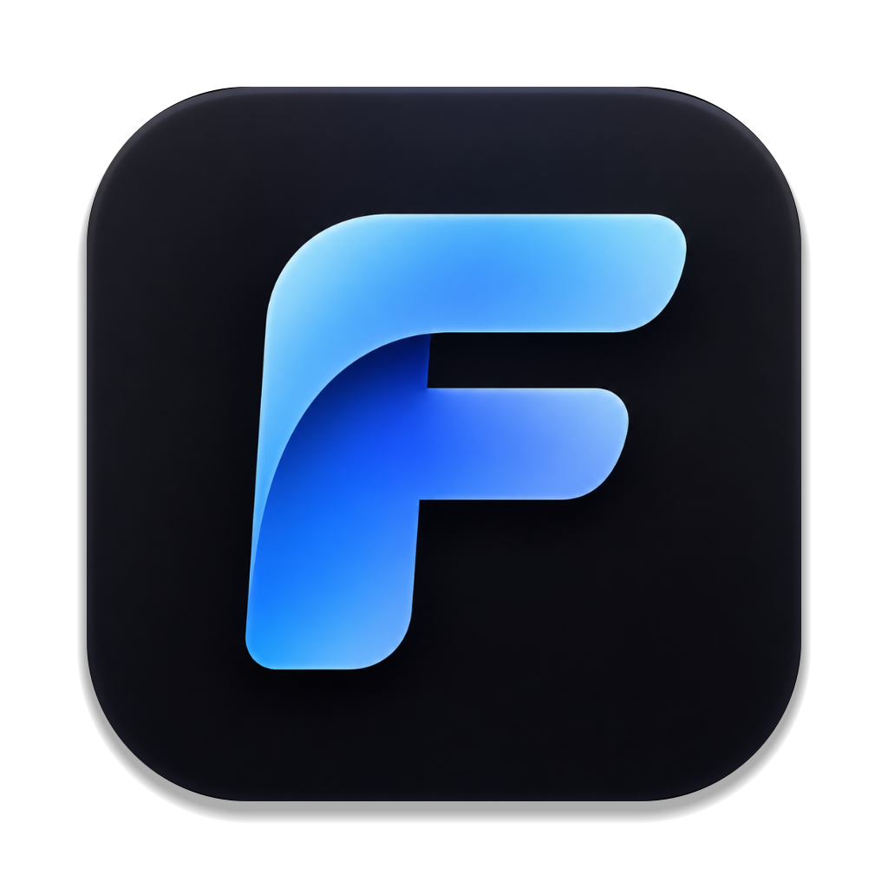

<p align="center">
  
</p>

<h1 align="center">Folix</h1>

<p align="center">
  <b>Быстрый двухпанельный файловый менеджер для macOS</b><br>
  Удобство классических «командеров» в облике родного приложения Mac
</p>

<p align="center">
  
  
  
  <a href="https://github.com/Bryal52/Folix/releases/latest"></a>
</p>

<p align="center">
  <a href="https://github.com/Bryal52/Folix/releases/latest/download/Folix-1.0.0.dmg"><b>⬇️ Скачать Folix 1.0.0 для macOS</b></a>
</p>

---

## ✨ О программе

Folix показывает файлы в двух панелях рядом: слева одно место, справа другое. Копировать, переносить и разбирать файлы так быстрее, чем перетаскивать их между окнами Finder. Всё основное делается с клавиатуры, а выглядит Folix как обычная программа для Mac: светлая и тёмная тема, системные шрифты и привычные окна.

## 🚀 Возможности

### 🗂 Две панели и горячие клавиши
Просмотр, копирование, перемещение, создание папок, удаление и переименование одной клавишей. Перетаскивание между панелями и из Finder. Правый клик открывает меню действий, а ⌘C / ⌘X / ⌘V работают и вместе с Finder.

### 📏 Размеры папок всегда на виду
Folix сам считает размер каждой папки и держит его в актуальном состоянии: изменили что-то на диске, и цифры обновились. Домашнюю папку с полумиллионом файлов он сканирует примерно за пару секунд. Сохранённые размеры хранятся в зашифрованном виде.

### 🖼 Превью при наведении
Наведите курсор на фото или видео, и через полсекунды появится миниатюра с разрешением и длительностью. По F3 открывается встроенный просмотр фото, видео и текста.

### ℹ️ Подробные свойства
Окно «Информация» (⌘I): точный размер, сколько файлов и папок внутри, даты создания и изменения, права доступа и свободное место.

### 💽 Флешки и внешние диски
Подключили флешку, внешний HDD или SSD, и Folix сам откроет её в панели. Служебные разделы, образы дисков и сетевые папки он пропускает. Диск можно безопасно извлечь прямо из программы.

### 📱 Телефоны и сетевые устройства
Файлы на телефоне по USB и на любом устройстве с FTP-сервером открываются так же, как папки на Mac. Подключения сохраняются, чтобы не вводить адрес каждый раз.

### 📦 Программы
Отдельный раздел со всеми установленными приложениями, их настоящими иконками и размерами. Сразу видно, что занимает больше всего места.

### 🎨 Понятные иконки
У каждого типа файлов своя иконка: архивы, видео, музыка, документы, установщики, образы дисков и многое другое.

### 🧾 Журнал ошибок
Folix записывает каждую ошибку: при копировании, подключении к устройству, открытии папки или подсчёте размеров. Если программа аварийно закроется, в журнал попадёт и место сбоя. Журнал открывается маленькой иконкой в правом нижнем углу (при наведении появляется подсказка «Логи»). Красная точка на ней значит, что появились новые ошибки. Записи можно скопировать одной кнопкой и отправить разработчику.

Файл журнала лежит в `~/Library/Logs/Folix/folix.log`, его видно и в программе «Консоль». Старые записи уходят в архив автоматически, поэтому журнал не разрастается.

## ⌨️ Горячие клавиши

| Клавиша | Действие |
|---|---|
| **F3** / ⌘3 | Просмотр |
| **F5** / ⌘5 | Копировать в другую панель |
| **F6** / ⌘6 | Переместить в другую панель |
| **F7** / ⇧⌘N | Новая папка |
| **F8** / ⌘⌫ | Удалить |
| **⇧F6** / F2 | Переименовать |
| **⌘I** | Свойства |
| **Пробел** | Пересчитать размер папки |
| **Tab** | Переключить панель |
| **⌫** / ⌘↑ | На уровень выше |
| **⇧⌘.** | Показать скрытые файлы |

> На Mac F-клавиши нажимаются вместе с **fn**, поэтому у каждой есть замена через ⌘.

## 📥 Установка

1. Скачайте **[Folix-1.0.0.dmg](https://github.com/Bryal52/Folix/releases/latest/download/Folix-1.0.0.dmg)** со страницы [релизов](https://github.com/Bryal52/Folix/releases/latest).
2. Откройте его и перетащите **Folix** в папку **«Программы»**.
3. При первом запуске macOS скажет, что не может проверить разработчика: у Folix нет платной подписи Apple. Откройте **Системные настройки → Конфиденциальность и безопасность** и внизу нажмите **«Всё равно открыть»**. Это нужно сделать только один раз.

**Требования:** macOS 27 или новее, Mac с чипом Apple (M1 и новее).

Для превью видео и работы с телефоном по USB понадобятся бесплатные утилиты:

```sh
brew install ffmpeg android-platform-tools
```

## 🛠 Сборка из исходников

Нужны macOS 27 или новее и Xcode Command Line Tools.

```sh
brew install cmake ninja qtbase qtmultimedia qtimageformats ffmpeg android-platform-tools
./build.sh
```

Скрипт соберёт `Folix.app`, положит внутрь всё необходимое, установит программу в папку «Программы» и создаст образ `dist/Folix-<версия>.dmg`.

## 🧩 Из чего сделан

C++20 и Qt 6, libcurl для работы по сети, ffmpeg для превью видео, системные API macOS для быстрого сканирования, слежения за изменениями и шифрования.

---

<p align="center">Сделано с любовью к порядку в файлах 🗃</p>
